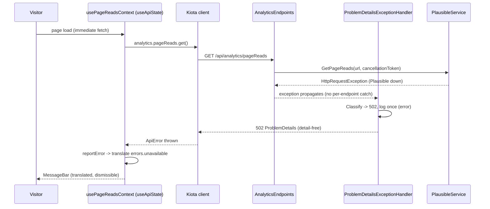
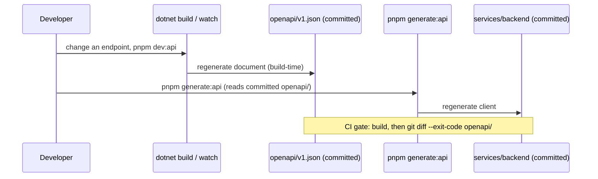

<!-- epic: optional. Set to the parent EPIC-XXX id when this feature belongs to an
     epic; leave "" for a standalone feature. Features are never nested under the
     epic folder, they only reference it here (flat model). -->

# Feature: Align the codebase with the technology-pack coding standards

## Problem & goal

The project adopted enforceable coding standards via the spec plugin (see `specs/enforcement.md`), but several standards are still violated or their prescribed patterns are still absent. The most visible gap is error handling: today a backend dependency failure (e.g. Plausible Analytics being unreachable) and an actual bug both surface as the same blank 500 response, and the frontend deliberately swallows API errors (console-only logging, `throwError: true` left on in the Kiota-wrapping contexts) — so a site visitor gets no feedback when something fails, and Jeroen gets no signal that the analytics backend is down.

Aligning the code with the standards:
- makes failures visible to the people who need to see them (a clear, translated message for the visitor; a correctly classified status code so failures are distinguishable in logs/monitoring for Jeroen),
- makes the test suite trustworthy (removing a placeholder test that asserts nothing, adding real coverage for validation and mapping logic),
- and makes the mechanical enforcement already wired in `eslint.config.js` and `dangerfile.ts` actually meaningful, instead of pointing at gaps the tooling can see but hasn't closed yet.

This spec covers exactly the open, implement-decided gaps recorded in `specs/enforcement.md` on 2026-11-20 by Jeroen (the maintainer), via the `/spec:enforce` ledger process. The measured evidence below (file counts, byte sizes, line counts) was gathered during that ledger run and during this spec's own verification pass against the current `main` tree; it is stated here, not re-derived by later phases.

## Scope

### In scope

Nine work areas, numbered as they were decided. Each is a candidate story seam for the scrum-master; the dependency notes below are hard constraints on split/ordering, not suggestions.

1. **Error-handling vertical** (two stories, strict dependency order — backend before frontend):
   - **(a) Backend — API-04 + CS-03.** Introduce an `AppException`/error-code classification, a central `IExceptionHandler` producing RFC 9457 `ProblemDetails`, and a kind-to-status mapping (dependency failure → 502, unclassified bug → 500). Remove the four duplicated per-endpoint `try/catch` blocks in `src/api/Bach.Software.Web/Endpoints/AnalyticsEndpoints.cs` (one `catch (ValidationException)` + one `catch (Exception)` in each of `GetPageReads` and `GetPageLikes`, each producing the same generic "Internal Server Error occurred" `ProblemDetails` regardless of cause) in favor of the central handler.
   - **(b) Frontend — FE-19.** Adopt the FE-19 reference implementation shipped in the plugin at `/Users/jeroenbach/Source/claude-plugins/plugins/spec/standards/vue/examples/FE-19/` (`useApiState.ts`, `useApiErrorReporter.ts`, `problemDetails.ts`, `useMessageStore.ts`, `MessageBar.vue`, `MessageBarOutlet.vue`, `MessageBarContext.vue`, `messageBarRegistry.ts`), adapted to the site's existing alert styling, and wrap the Kiota client calls currently made in `src/app/contexts/usePageReadsContext.ts` and `src/app/contexts/usePageLikesContext.ts` (both currently set `throwError: true` on `useAsyncState` with the comment "show in the console, but not to the user") in `useApiState`, so a failed page-reads/page-likes fetch reaches the visitor instead of only the browser console. Add an `errors.*` translation catalog to the locale files (`src/app/locales/*.json`): small generic buckets (`errors.unexpected`, `errors.unavailable`, validation pass-through) plus one entry per concrete backend error code as story 1a introduces them, held in sync by the error-code contract test from the standard (adopted as-is). The reference ships without tests; unit tests are written per FE-06 as part of this story.

     This decision **supersedes** the earlier assumption of reusing the existing notification infrastructure (decision 8 in the Decision log, with the verified rationale). Migration included in this story: the only two current consumers of `useNotificationStore` — the copy-notification in `src/app/components/content/CodeGroup.vue` and the `languageAiTranslated` toast in `src/app/contexts/AppHeaderContext.vue` — move to `useMessageStore`; then `AlertBar.vue`, `AlertBarContainer.vue`, `NotificationMessage.vue`, `NotificationContainer.vue`, and `useNotificationStore.ts` are removed, `specs/components.md` is updated, and their Storybook stories / visual-regression entries are deleted (the MessageBar stories are added by the FE-13 story, area 6, after FE-14). The `ProblemDetails`/`ValidationProblemDetails`/`ApiError` types in `src/app/types/` are reconciled with the reference's `problemDetails.ts` type guards rather than kept as a parallel set.

2. **CS-04 — CancellationToken propagation.** Thread a `CancellationToken` through the full async chain: both endpoint handlers in `AnalyticsEndpoints.cs` (`GetPageReads`, `GetPageLikes`) and three methods in `src/api/Bach.Software.Infrastructure/PlausibleAnalytics/Services/PlausibleService.cs` (`GetPageReads`, `GetPageLikes`, `SendRequest`, the last of which calls `_httpClient.SendAsync`). CA2016 only fires once a token is in scope to forward — today the solution has zero `CancellationToken` parameters, so the analyzer has nothing to flag. (Factual correction, research: CA2016 and CA1068 default to "suggestion", which `TreatWarningsAsErrors` does not promote; the CS-04 story must add explicit `= warning` severities for both in `src/api/.editorconfig` to make them warnings-as-errors.)

3. **CS-02 — Backend test hygiene.** Delete the dead placeholder test `src/api/Bach.Software.Tests/PageReadsTest.cs` (its one test method is `Assert.True(true)`, with a comment saying it's "superseded by the real integration test in `AnalyticsEndpointTests`"). Add direct unit tests for `UrlInputValidator` and for `PlausibleService`'s result-mapping logic (the `resultsDict.GetValueOrDefault(...)` projections in `GetPageReads`/`GetPageLikes`). Name tests `MethodName_Scenario_ExpectedBehaviour`.

4. **API-01 — Committed OpenAPI document.** Generate the OpenAPI document at build time via `Microsoft.Extensions.ApiDescription.Server` into a committed `openapi/` folder, with a CI staleness gate (`git diff --exit-code` after regenerating). Point Kiota at the committed document instead of a running dev server to generate the frontend client (`src/app/services/backend/`). Update `src/app/services/backend/README.md` to describe the new flow.

5. **FE-14 — Visual-regression baselines out of git** (decided by Jeroen during the ledger run, **supersedes** the earlier committed-baselines deviation recorded in `specs/enforcement.md`). Move Playwright visual baselines out of git into object storage per the vue pack's standard. Measured current state: 87 PNGs committed under `src/app/tests/playwright/` (70 files / 25MB in `components.spec.ts-snapshots/`, 17 files / 15MB in `pages.spec.ts-snapshots/`), contributing to a 248MB repo pack. Affects: `20-build-deploy-playwright.yml` (verification path), `30-update-snapshots.yml` (likely becomes obsolete once baselines no longer live in a branch commit), `.claude/hooks/block-snapshot-image-edits.sh` (currently blocks hand-edits to the committed PNGs — needs rethinking once they're not in the working tree), and the CLAUDE.md sections describing snapshot regeneration. **Cloudflare R2 is pre-approved as the object storage** (Decision log, decision 2); the architect decides only the publisher tooling detail (reg-suit's S3-compatible publisher vs. an equivalent). Existing git history keeps its already-committed blobs; a history rewrite is explicitly **out of scope** (Decision log, decision 3).

6. **FE-13 — Storybook coverage.** Measured gap: 24 of ~39 presentational components have no story at all; 6 of the 13 existing story files are Default-only (`AppHero`, `CurriculumVitaeTable`, `PortfolioGrid`, `AppHeader`, `ChipLink`; `AlertBar` renders all four severities inside one story instead of one state per story). Add the missing stories and split the Default-only ones into one story per meaningful state. **Cross-impact from area 1b:** do not plan stories for the components retired there (`AlertBar`, `AlertBarContainer`, `NotificationMessage`, `NotificationContainer`); `MessageBar`/`MessageBarOutlet` get the stories instead (the per-severity state coverage that would have fixed `AlertBar`'s one-story problem lands on `MessageBar`). Each story must be registered in the Playwright visual-regression spec `src/app/tests/playwright/components.spec.ts` per existing project convention. **Hard sequencing constraint: this story must run after the FE-14 story**, so the new screenshots this work produces land in the new object-storage bucket, not back into git.

7. **FE-05 — Shared file naming.** Rename the ~14 utility files in `src/app/utils/` to carry a `Util` suffix (e.g. `url.ts` → `urlUtil.ts`), and rename the 2 composables that don't follow `use*` naming (`src/app/composables/destructiblePinia.ts`, `src/app/composables/refReactiveDefault.ts`) to `use*` names. Fix every import site. Wire a filename-case lint rule (`unicorn/filename-case` or equivalent, scoped per folder) so the convention holds going forward — `specs/enforcement.md` notes this wasn't wired previously because the convention itself didn't exist yet.

8. **FE-07 — data-testid naming convention.** Adopt the pack standard exactly as written, no custom convention (Decision log, decision 4): attribute `data-testid`, lowercase kebab-case `<context>-<purpose>-<elementtype>` names using the standard's fixed elementtype list, the standard's coverage rules (interactive elements, test scopes, asserted values; no blanket tagging of everything), scoped uniqueness, and the `baseDataTestid` prop pattern (defaulting to the component's own kebab-case name) for reusable components. Record the convention in `specs/PROJECT.md`, roll it through the existing Playwright specs (`src/app/tests/playwright/`), and wire a lint selector that enforces it going forward.

9. **Combined micro-cleanup story** (small, unrelated fixes grouped to avoid one-item stories):
   - **FE-02** — map the `PageReads` API type that currently leaks into `src/app/components/BlogPost.vue`'s props to a view model instead; replace `SearchModal.vue`'s `loading`/`unavailable` boolean pair with a single `status` prop; rename `SearchButton.vue`'s bare `click` emit to a named domain event.
   - **FE-04** — move the 5 builder files currently in `src/app/components/__tests__/` (`authorBuilder.ts`, `pageBuilder.ts`, `postBuilder.ts`, `blogBuilder.ts`, `companyBuilder.ts`) out of the components folder.
   - **FE-08** — translate the 6 hardcoded user-facing strings found: `"Close"` (×2, in `AlertBar.vue` line 98 and `NotificationMessage.vue` line 148, both `sr-only` labels), `aria-label="Global"` and `"Open main menu"`/`"Close menu"` (`AppHeader.vue` lines 54, 95, 140), and `title="Switch color mode"` (`ColorModeSwitcher.vue` line 36). Note the cross-impact from area 1b: `AlertBar.vue` and `NotificationMessage.vue` are retired there, so their two `"Close"` strings resolve by replacement — the obligation transfers to `MessageBar`'s equivalent close label, which must use `$t(...)` from the start. If this story runs after the error-handling stories, re-verify the hardcoded-string list against the then-current tree instead of applying it blindly. Optionally wire the `@intlify/eslint-plugin-vue-i18n` no-raw-text rule while here, since `specs/enforcement.md` already flags it as a candidate.

### Out of scope (explicit)

- **FE-12 (Loading Promise Pattern)** — stays ignored per the existing `specs/PROJECT.md` deviation, until a feature introduces a parent-owned async action. Not reopened by this feature.
- Anything in `specs/enforcement.md` already marked **Enforced** or **Not applicable** — this feature only touches the rows marked **Open**, **Review only** (where the idea explicitly calls them in), or a deviation being superseded.
- Rewriting git history to reclaim the space of the already-committed 40MB of baseline PNGs (FE-14). Moving baselines out of git going forward is in scope; purging their existing blobs from history is not (decided: no rewrite, may be revisited later as a separate effort — Decision log, decision 3).
- For FE-14, everything beyond the publisher tooling detail: the storage destination is decided (Cloudflare R2, Decision log, decision 2); only reg-suit's S3-compatible publisher vs. an equivalent remains an architecture choice.
- Any standard not named in the numbered list above, including everything in the `csharp`/`dotnet-api`/`vue` packs not called out (e.g. API-02, API-03, API-05, FE-01, FE-03, FE-06, FE-09 through FE-11, FE-15 through FE-18, FE-20, CS-01) — those are already enforced or compliant per the ledger and are not touched here.

## Functional overview

User-facing (site visitor) behavior changes only around the error-handling vertical (area 1):
- When the `/api/analytics/pageReads` or `/api/analytics/pageLikes` backend calls fail, the visitor now sees a translated, dismissible `MessageBar` message instead of silent failure with no feedback. Messages are resolved from backend error codes through the `errors.*` translation catalog, never by rendering backend title/detail prose directly; a backend dependency outage and an unclassified bug map to generic buckets (`errors.unavailable`, `errors.unexpected`) while the standard's status-code distinction (502 vs 500) serves Jeroen's logs/monitoring, not a different visitor-facing message per failure kind.
- The two existing toast-style notifications (the code-copy confirmation in `CodeGroup` and the AI-translated-language notice in the header) keep their behavior but render through the new `MessageBar` infrastructure after the migration in area 1b; the retired `AlertBar`/`NotificationMessage` components disappear without any visitor-visible loss, since MessageBar adopts the site's existing alert styling.
- No other visitor-facing behavior changes. All other areas (2–9) are internal engineering/process alignment: test hygiene, OpenAPI/client generation flow, CI storage of visual baselines, Storybook coverage, file naming, test-id conventions, and small component-interface cleanups. None of them change what a visitor sees or does, except area 9's FE-08 translations, which replace hardcoded English strings with the already-existing locale mechanism so non-English visitors see those UI labels (close buttons, mobile menu toggle, color-mode switcher title) in their own language instead of always in English.

For Jeroen as maintainer: backend failures are now classifiable (dependency failure vs. bug) in whatever observability he has on the 502/500 split; the Storybook/visual-regression/file-naming/test-id work reduces future review burden by giving the already-wired mechanical enforcement (lint, danger, CI) more surface to actually check.

## Design (feature level)

**Design phase skipped — confirmed by the maintainer** (Decision log, decision 1). The error-handling vertical (area 1b) introduces the `MessageBar`/`MessageBarOutlet` components from the FE-19 reference implementation, but they adopt the site's existing alert styling (the look of the retired `AlertBar`/`NotificationMessage`), so there is no new visual language to prototype. The review phase checks the error microcopy. FE-08's translations swap hardcoded strings for `$t(...)` calls with no visual change. FE-13's added Storybook stories document existing component states, they don't create new ones.

## Architecture (feature level)

Decisions for the whole feature. Numbering matches the nine Scope areas; the Component/module plan, Public surface impact, Documentation impact, Data flow, ADR notes, and Slicing seams sections below cut across them.

### Component/module plan

Backend (areas 1a, 2, 3, 4):

- **New (area 1a) — error-handling layer, adopting the dotnet-api pack's `examples/API-04/` reference.** `ErrorCode` + `FailureKind` and `AppException` (HTTP-free) go in `Bach.Software.Application` (it is the inmost layer the Web handler and services can both see; `Core` holds only generic utilities and `Application` already owns Models/Validation/Interfaces). The typed catalog `ErrorCodes` also lives in `Application`. The single `ProblemDetailsExceptionHandler : IExceptionHandler` is new in `Bach.Software.Web/ErrorHandling/` (the folder `dangerfile.ts` already watches alongside `Endpoints/**` for API-03). Nothing in `specs/components.md` covers backend types; no justification needed there (that inventory is frontend-only per the profile).
- **Modified (area 1a) — `AnalyticsEndpoints.cs`.** Remove both per-endpoint `try/catch` blocks (the `catch (ValidationException)` + `catch (Exception)` pairs in `GetPageReads`/`GetPageLikes`) and the `LogUnexpectedError` logger message; the handler now owns classification and the single log. `ValidateAndThrowAsync` keeps throwing `FluentValidation.ValidationException`, which gets one arm in the handler's `Classify` → 400 `ValidationProblemDetails` (reusing the existing `ToValidationProblemDetails` projection shape, moved into the handler). Backward compatible for the only consumer (the frontend Kiota client), which already handles 400 validation problems; see Public surface impact for the 500→502 change.

  > **PROPOSED (adversarial review) — validation must carry codes, not English messages, and the handler needs an explicit ValidationException branch.** Two concrete changes so the validation path does not reproduce the "translate by message text" anti-pattern (finding 1): (a) the `errors` dictionary values must be *error codes* the frontend can translate as `errors.${code}`, not FluentValidation's default `ErrorMessage` prose. Set an explicit code per rule (e.g. `.WithErrorCode("urlRequired")`) in `UrlInputValidator` and project `e.ErrorCode` (not `e.ErrorMessage`) in the handler's validation projection, and add a matching `errors.*` catalog entry for each so the FE-19 reporter and the contract test cover them. (b) The API-04 reference's `CreateProblemDetails` returns a detail-free `new ProblemDetails()` for any non-`AppException`; since `FluentValidation.ValidationException` is not an `AppException`, the handler needs its own explicit `ValidationException` branch that builds the field dictionary, in addition to the `Classify` arm. Alternative the maintainer may prefer: treat the two analytics endpoints' 400 as not-user-facing (it is unreachable from the frontend) and keep validation messages as already-localized backend text rendered verbatim, accepting the deviation from FE-19's code-translation model and documenting it. Either way, resolve the inconsistency explicitly rather than reusing the message-emitting projection under a code-translating reporter.

  DECIDED (maintainer): Error codes. Adopt changes (a) and (b) as proposed; the verbatim-backend-text alternative is rejected. "Validation pass-through" in decision 7 means the FE-19 validation expansion (one translated line per field), not rendering backend prose.
- **Modified (area 1a) — `Program.cs`.** Register exactly one handler via `AddExceptionHandler<ProblemDetailsExceptionHandler>()` + `AddProblemDetails()`, add `UseExceptionHandler()` to the pipeline, suppress the middleware's duplicate error log (`ExceptionHandlerOptions.SuppressDiagnosticsCallback`), and declare the API-wide failure classes (500, 502) once on the root group. `Program.cs` stays a composition root.

  > **AMENDMENT (flagged by ST-01 implementation):** `ExceptionHandlerOptions.SuppressDiagnosticsCallback` does not exist on .NET 9 (it arrived in .NET 10). The same outcome (one error-level log per failed request) is reached with a logging filter on the exception-handling middleware's category that drops its Error entries. Behaviour and tests are unchanged; revisit when the API moves to .NET 10.
- **Modified (area 2) — `IAnalyticsService`, `PlausibleService.cs`, `AnalyticsEndpoints.cs`.** Thread `CancellationToken cancellationToken` as the last parameter through `GetPageReads`/`GetPageLikes` (interface + impl + endpoint handlers) and `SendRequest`, forwarding into `_httpClient.SendAsync(request, cancellationToken)` and `response.Content.ReadAsStringAsync(cancellationToken)` (the existing synchronous `JsonSerializer.Deserialize` on the read string needs no token). The interface change is source-compatible (one new required parameter; the only caller is the endpoint layer, updated in the same story). CA2016/CA1068 then hold the line, once the CS-04 story adds explicit `= warning` severities for both in `src/api/.editorconfig` (they default to "suggestion", which `TreatWarningsAsErrors` in `Directory.Build.props` does not promote; factual correction, research).
- **Modified (area 3) — delete `Bach.Software.Tests/PageReadsTest.cs`; add `UrlInputValidatorTests` and `PlausibleServiceTests`.** The service's result-mapping (`resultsDict.GetValueOrDefault(...)`) is today only reachable through the Infrastructure class with a real `HttpClient`; test it with `RichardSzalay.MockHttp` (already a Tests dependency) the way `AnalyticsEndpointTests` does, asserting the `PageReads`/`PageLikes` projections. Names follow `MethodName_Scenario_ExpectedBehaviour` (the Tests project already suppresses CA1707 for this).
- **New (area 4) — committed `openapi/` document + `pnpm generate:api`.** `Microsoft.Extensions.ApiDescription.Server` (PrivateAssets=all) added to `Bach.Software.Web.csproj` with `OpenApiGenerateDocuments=true` and `OpenApiDocumentsDirectory=$(MSBuildProjectDirectory)/../../../openapi` (repo-root `openapi/`). The existing runtime `AddBachSoftwareOpenApi` document transformer (server URL `/api`, path-trim) is preserved and, confirmed against the .NET 9 docs, also runs during build-time generation (the build tool launches the app entrypoint with an inert server and uses the real document pipeline), so the committed document carries the same `/api` server + unprefixed paths the Kiota client depends on. The existing `app.MapOpenApi()` dev endpoint and `OpenApiDocumentTests` stay (still useful, with `PageReads_DeclaresTypedResponses` extended to assert the new 502 declaration); the new contract gate is the `openapi/` diff.

Frontend (areas 1b, 5, 6, 7, 8, 9):

- **New (area 1b) — adopt the vue pack's `examples/FE-19/` reference**, adapted (see ADR 1b-A): `useApiState.ts`, `useApiErrorReporter.ts`, `useMessageStore.ts` into `src/app/composables/`; `MessageBar.vue`, `MessageBarOutlet.vue`, `messageBarRegistry.ts` into `src/app/components/`; `MessageBarContext.vue` into `src/app/contexts/`. `problemDetails.ts` reconciles the existing `~/types/ProblemDetails.ts`, `ValidationProblemDetails.ts`, `ApiError.ts` into the reference's shape (kept in `~/types/`, matching the project's existing placement of runtime guards like `isApiError`; FE-05's util-suffix rule is scoped to `utils/`+`composables/` per decision 5, so `types/` is untouched).
- **Modified (area 1b) — wire the two analytics contexts.** `usePageReadsContext.ts` and `usePageLikesContext.ts` drop `useAsyncState(..., { throwError: true })` in favour of `useApiState`, so a failed fetch reports through `useMessageStore` instead of only the console. `mapData` stays near-identity (FE-19). The FE-12 pieces of the reference (`executeWithResolve`, the `@/utils/loadingPromise` import) are dropped: FE-12 is a standing profile deviation and no `loadingPromise` util exists; this keeps the adoption from pulling FE-12 in early.
- **Modified (area 1b) — migrate the two `useNotificationStore` consumers** (plus `PageReadProgress.vue`, which renders `NotificationMessage` directly and moves to a floating `<MessageBar fixed>` so it keeps its position, see ST-06), then retire the old infrastructure. `CodeGroup.vue` (copy confirmation) and `AppHeaderContext.vue` (`languageAiTranslated` toast) move to `useMessageStore.addSuccess`/`addInfo`. The store-driven `MessageBar` rendering moves to the app root following the reference's `AppContent.vue` (MessageBarContext wrapping the layout; a MessageBarOutlet mounted once), which removes the current prop-drilled `notifications` path through `AppHeader` (see Public surface impact). Then delete `AlertBar.vue`, `AlertBarContainer.vue`, `NotificationMessage.vue`, `NotificationContainer.vue`, `useNotificationStore.ts` (+ `useNotification.nuxt.test.ts`).
- **New (area 1b) — `errors.*` catalog + contract test.** Add the `errors.unexpected` / `errors.unavailable` / validation-passthrough buckets plus one entry per backend code to `src/app/locales/{en,nl,de}.json`, and adopt API-04's `errorCodes.contract.spec.ts` as-is against the backend-generated `error-codes.json` (new backend sync test in area 1a).
- **Area 5 (FE-05)** — rename the ~14 `src/app/utils/*.ts` to `*Util.ts` and `destructiblePinia.ts`/`refReactiveDefault.ts` to `use*` names; fix import sites; wire a per-folder `unicorn/filename-case` rule scoped to `utils/`+`composables/`.
- **Area 6 (FE-13)** — add the missing stories and split the Default-only ones; register each in `components.spec.ts`. No stories for the retired components; `MessageBar`/`MessageBarOutlet` get the per-severity state coverage.
- **Area 7 (FE-07)** — roll out `data-testid` across the Playwright specs and reusable components, record the convention in `specs/PROJECT.md`, wire the lint selector.
- **Area 8 (FE-08)** — translate the remaining hardcoded strings; re-verify the list against the then-current tree (area 1b retires two of the flagged files).
- **Area 9 (FE-02/04)** — map `PageReads` out of `BlogPost.vue`'s props to a view model; collapse `SearchModal.vue`'s `loading`/`unavailable` booleans into one `status` prop; rename `SearchButton.vue`'s bare `click` emit; move the 5 builders out of `components/__tests__/`.

### Public surface impact

Per the profile this is a private app with no semver/changelog/release bookkeeping; "public surface" means the two inventoried surfaces below. No external-consumer breakage exists by construction. Merge-to-`main` is the only release step.

- **Backend OpenAPI contract (consumed only by the frontend Kiota client).** Changes: (1) a failing Plausible call now returns **502** instead of **500** (area 1a + ADR 1a-A); (2) 4xx/validation responses carry machine-readable `code` + `placeholders` extensions; (3) the committed `openapi/` document is new and becomes the generation source (area 4). Release impact: regenerate the client (`pnpm generate:api`) in the same PR; the generated client and `errors.*` catalog stay in lockstep via the two contract tests. The 500→502 move updates two existing assertions in `AnalyticsEndpointTests` (`GetPageLikes_WhenPlausibleRequestFails_*`, `...ResponseCannotBeDeserialized_*`) from `InternalServerError` to `BadGateway`.

  > **PROPOSED (adversarial review) — keep the problem schemas in the committed document and account for `OpenApiDocumentTests` (finding 2).** The Kiota client only parses a non-2xx body into the `additionalData` bag that `toProblemDetails` reads (giving the visitor `errors.unavailable` instead of the generic `errors.unexpected`) for status codes declared with a `ProblemDetails`/`ValidationProblemDetails` schema in `openapi/`. So area 1a must *preserve* the endpoints' typed `Results<Ok<...>, BadRequest<ValidationProblemDetails>, ProblemHttpResult>` return unions (removing only the try/catch bodies, not the typed branches) and ensure the root-group `.ProducesProblem(500)`/`.ProducesProblem(502)` metadata declares 502 with the `ProblemDetails` schema -- otherwise the committed document loses the 400/500 schemas and the client stops parsing structured errors. Correspondingly, `OpenApiDocumentTests.PageReads_DeclaresTypedResponses` asserts a `500` response and a `400` `ValidationProblemDetails` ref; add it to the list of tests area 1a/4 must re-verify (and extend to assert the new `502`), rather than stating these tests "stay" unchanged.

  DECIDED (maintainer): adopted as written, with the added status mapping in `useApiErrorReporter`; see the decision under finding 2 in Adversarial review.
- **Frontend shared inventory (`specs/components.md`).** Removed: AlertBar, AlertBarContainer, NotificationMessage, NotificationContainer. Added: MessageBar, MessageBarOutlet (presentational), MessageBarContext (context). AppHeader loses its `notifications?` prop and the `Notification` import/`NotificationContainer` mount (messages now render store-driven at the app root, not prop-drilled). BlogPost's `pageReads?: PageReads` prop becomes a view-model prop (area 9/FE-02). Context list gains `MessageBarContext`; `useNotificationStore` is replaced by `useMessageStore`. FE-05 renames do not appear in the inventory (utils/composables are not inventoried shared components).
- **data-testid names (area 7)** are a test-facing contract; since this feature introduces the convention, no pre-existing ids break. The reference MessageBar's ids (`message-bar`, `message-bar-close`, `message-bar-content`) are adjusted to the FE-07 `<context>-<purpose>-<elementtype>` form during area 7 (e.g. `message-bar-close-button`); area 8/7 re-verify against the then-current tree.

### Documentation impact

The profile defines documentation as `specs/components.md` only; there is no docs site. Required edits:

- **`specs/components.md`** — apply the Added/Removed/Modified deltas above (area 1b, area 9). This is the one living documentation artifact and is updated by the stories that change the surface.

Process/config artifacts that are not "documentation" but must be edited by their stories (recorded here so no story treats them as optional): `specs/enforcement.md` (FE-05/FE-07/FE-14/API-01/API-04/CS-04 rows move off "Open"/"Review only"), `CLAUDE.md` (snapshot-regeneration + FE-14 storage sections, FE-07 convention, FE-05 naming), `specs/PROJECT.md` (FE-07 convention per decision 4), `src/app/services/backend/README.md` (API-01 generation flow), and `eslint.config.js` (new filename-case + testid selectors; the FE-20 allow-path for `destructiblePinia.ts` is updated when that file is renamed in area 5, in four occurrences).

### Data flow

**Error-handling vertical (areas 1a/1b).** State: errors live transiently in the destructible `useMessageStore` (Pinia, instance-scoped, cleared on the reporting component's unmount unless persisted). No error state is persisted across reloads. Concurrency: `useApiState` runs each call through its polling loop; a re-execution calls `clear()` first so a stale error never outlives its retry. Lifecycle: `MessageBarContext` provides the outlet registry; the most recently mounted `MessageBarOutlet` receives new bars (only one outlet exists here, the app-root one). Reactivity trap to respect: `useMessageStore` destructures a `defineDestructibleStore` result, which is why FE-20's wrapper (not bare Pinia) is mandatory; the FE-05 rename of `destructiblePinia.ts` must keep that wrapper's single import path intact.

**OpenAPI/client flow (area 4).**

### ADR notes

- **ADR 1a-A — Plausible failure classification (502 vs 500).** Context: today both a Plausible HTTP failure and an unparseable response surface as 500. Decision: both map to **502** ("retry later"), reserving 500 for genuine bugs, per API-04's dependency-failure arm. `HttpRequestException` (from `EnsureSuccessStatusCode`) propagates unwrapped and gets a 502 arm; the deserialize-null case throws a dedicated Infrastructure exception type (not `AppException`, not a bare `InvalidOperationException`) that gets its own 502 arm, because a malformed dependency response is the dependency failing, not a defect in our code. Alternative considered: leave the deserialize-null case at 500 (reference `_` arm). Rejected: it is indistinguishable in monitoring from a real bug, which is exactly what the 502 split exists to prevent. Both existing endpoint tests move from 500 to 502.

  DECIDED (maintainer): 502 for the unparseable-response case, as decided here.
- **ADR 1b-A — adopt the FE-19 reference, adapted, over the existing notification stack.** Context/decision/rationale are already settled in Decision log entry 8 (the maintainer's). Architecture-level adaptations fixed here: rewrite `@/` aliases to the project's `~/`; keep problem-details types in `~/types/`; drop the FE-12 `executeWithResolve`/`loadingPromise` coupling (deferred deviation); reconcile the Kiota error shape (`responseStatusCode`, read during implementation against the generated client, not the old `~/types/ApiError.ts` `status` guess); map a 502/503 response status to `errors.unavailable` inside `useApiErrorReporter` (a detail-free 5xx carries no code, so the reference would otherwise fall through to `errors.unexpected`). Alternative (reuse `useNotificationStore`) rejected by the maintainer in Decision log 8.
- **ADR 4-A — build-time OpenAPI via `Microsoft.Extensions.ApiDescription.Server`.** Decision fixed by maintainer decision 6. Verified against the .NET 9 OpenAPI docs: build-time generation launches the app entrypoint with an inert server and runs the real document pipeline, so registered document transformers apply and no live server is needed. Assumption to confirm in area 4: the generator starts `Program` up to `app.Run()`; `PLAUSIBLE_API_TOKEN` is read lazily in the `PlausibleService` singleton ctor (first request only), not at startup, so build-time generation should not require secrets. If a future startup resolution changes that, provide a dummy token to the generator step.
- **ADR 5-A — reg-suit S3 publisher against Cloudflare R2 (FE-14).** Context: R2 is the pre-approved store (decision 2); the only open choice is the publisher tooling. Decision: use `reg-publish-s3-plugin` pointed at R2's S3-compatible endpoint via `sdkOptions` (`endpoint` = the R2 `https://<accountid>.r2.cloudflarestorage.com` URL, `forcePathStyle: true`, `region: 'auto'`, credentials from `$AWS_ACCESS_KEY_ID`/`$AWS_SECRET_ACCESS_KEY` env, never inline), plus `reg-keygen-git-hash-plugin` and `reg-notify-github-plugin`. Alternative considered: `reg-publish-gcs-plugin` (rejected: needs a GCP account, contradicts the R2 decision) and keeping committed baselines (rejected: explicitly superseded). There is no dedicated "R2 plugin"; R2's S3 compatibility is the supported path. Provisioning flags for the FE-14 story (not architecture blockers, but surface them to the maintainer): (1) the reg-suit GitHub App must be installed and its `clientId` stored as `REG_NOTIFY_CLIENT_ID`; (2) the PR report link points into the bucket, so R2 needs a public `r2.dev`/custom-domain read path or the report is private; (3) CI checkout needs `fetch-depth: 0` (the git-hash plugin needs the merge-base), which the current `actions/checkout@v3` default depth does not give; (4) reg-suit issue #162: do not set `customDomain` and `endpoint` together or the report URL breaks, so model the public read path through one of them only (superseded for this plugin version by the DECIDED (maintainer) entry below: `customDomain` is set to the host-only `r2.dev` host).

  DECIDED (maintainer): Provisioning is done. The bucket is `bach-software-visual-regression`, and its public read path is the `r2.dev` URL `https://pub-f40905f3c59f4f2bbc195e223d7f0de2.r2.dev` (see the follow-up decision below on `customDomain`). Both are non-secret and go straight into the reg-suit config. The repository secrets `AWS_ACCESS_KEY_ID` and `AWS_SECRET_ACCESS_KEY` (the R2 credentials) and `REG_NOTIFY_CLIENT_ID` exist, and there are no repository variables. The R2 endpoint is built from the existing `CLOUDFLARE_ACCOUNT_ID` secret (`https://<accountid>.r2.cloudflarestorage.com`). Only `fetch-depth: 0` in CI remains for the story to do.

  DECIDED (maintainer): `customDomain` is set to the host-only `pub-f40905f3c59f4f2bbc195e223d7f0de2.r2.dev` (no scheme), so the report link in the PR comment opens. This supersedes the "`customDomain` stays unset" part of the provisioning entry above.
  Why: in `reg-publish-s3-plugin` 0.14.4 the report URL is built as `https://${customDomain ?? bucketName + '.s3.amazonaws.com'}/<key>/index.html` and `customDomain` is used for nothing else (not for the S3 client), so leaving it unset produces a link to `s3.amazonaws.com` that cannot open. Reg-suit issue #162 does not apply to this plugin version.
  Sources: `reg-viz/reg-suit` `packages/reg-publish-s3-plugin/src/s3-publisher-plugin.ts` (read by the ST-10 verifier).

### Slicing seams and hard sequencing (input for the scrum-master)

Independently deliverable slices, with the spec's hard constraints restated as blocking edges:

- **1a backend error-handling** — blocks 1b (frontend needs classified ProblemDetails + the generated `error-codes.json`). Must land first in area 1.
- **1b frontend error-handling** — depends on 1a. Carries the FE-06 tests, the `errors.*` catalog + contract test, the notification→MessageBar migration, and the components.md delta.
- **2 CS-04 cancellation** — independent of 1a's handler but touches the same `AnalyticsEndpoints.cs`/`PlausibleService.cs`; sequence after 1a to avoid edit collisions in those two files (soft constraint, not a hard dependency).
- **3 CS-02 test hygiene** — independent; nets coverage positive (quality-gate requirement).
- **4 API-01 openapi/** — independent of area 1, but if 1a changes the error responses, regenerate `openapi/` + client after 1a to avoid a second churn (soft). The CI staleness gate is part of this slice.
- **5 FE-05 renames** — independent; keep rename-only commits separate from behaviour changes (constraint in Constraints & assumptions). Touches the FE-20 eslint allow-path for `destructiblePinia`.
- **6 FE-13 Storybook** — **hard: after 5-FE-14.** New screenshots must land in object storage, not git.

  > **PROPOSED (adversarial review) — resolve who owns the MessageBar stories and apply the FE-14 edge to them (finding 3).** Scope area 1b and area 6 currently both claim the MessageBar stories/visual-regression entries. Assign them to the **FE-13 story (area 6) only**, which already carries the hard "after FE-14" edge, so the new MessageBar baselines are captured into object storage. Area 1b then only (a) deletes the retired `AlertBar`/`AlertBarContainer`/`NotificationMessage`/`NotificationContainer` components and their committed baseline PNGs + `components.spec.ts` entries, and (b) ships `MessageBar`/`MessageBarOutlet` without stories for the interim (the FE-13 danger rule warns, not fails; FE-13 closes it). This keeps the error vertical (1a→1b) early without dragging it behind FE-14. If the maintainer instead wants MessageBar stories inside 1b, add an explicit hard edge **1b after 5-FE-14** and note the resulting pull of the whole error vertical to late in the feature.

  DECIDED (maintainer): The FE-13 story (area 6) owns the MessageBar/MessageBarOutlet stories and their visual-regression entries, so the baselines land in object storage. Area 1b deletes the retired components and their committed baselines and `components.spec.ts` entries, and ships MessageBar without stories in the interim. No 1b-after-FE-14 edge is added.
- **5-FE-14 baselines-out-of-git** — **hard: before 6-FE-13.** Rewrites the capture mechanism (`toHaveScreenshot` → `page.screenshot` capture + `reg-suit run`), the two workflows, and retires `.claude/hooks/block-snapshot-image-edits.sh` (its target dirs disappear).
- **7 FE-07 data-testid** and **8 FE-08 translations** — independent; both re-verify against the then-current tree because 1b retires components they reference. 8 after 1b where the two retired `"Close"` strings resolve by replacement.
- **9 micro-cleanup (FE-02/04/08 subset)** — mostly independent; FE-02's `BlogPost` view-model change touches a component in the inventory (coordinate the components.md edit with 1b's edit to avoid conflicts).

UI-surface slices (6-FE-13, parts of 7) stay separate from engine/backend slices (1a, 2, 3, 4) as the pack guidance expects.

## Adversarial review

Verified against the current `main` tree, the two pack reference implementations (`vue/examples/FE-19/`, `dotnet-api/examples/API-04/`), and external docs where a claim was load-bearing. The architecture is unusually thorough; the findings below are the seams where it is internally inconsistent or under-specified, not gaps in the direction.

1. **(should-fix) Validation field errors would render as untranslated raw text, reproducing the exact anti-pattern decision 8 retires.** Area 1a says to reuse the existing `ValidationExceptionExtensions.ToValidationProblemDetails` projection "moved into the handler." But that projection emits FluentValidation's English `ErrorMessage` strings as the values of the `errors` dictionary (verified: `g.Select(e => e.ErrorMessage)`), while FE-19's `useApiErrorReporter.toFieldErrors` treats every `errors` value as a translatable *code* and calls `t('errors.${value}')` on it (verified in `useApiErrorReporter.ts`). The result is `t('errors.\'Url\' must not be empty.')` rendering the raw key, i.e. "translating by message text" -- the named FE-19 counter-example and the stated reason to drop `useNotificationStore`. The error-code contract test does not catch this because validation messages are not enumerated in `error-codes.json`. Second, mechanically, the API-04 reference handler cannot produce this body as-is: `CreateProblemDetails` returns a detail-free `new ProblemDetails()` for any `exception is not AppException`, and a `FluentValidation.ValidationException` is not an `AppException`, so adding a `Classify` arm alone yields an empty 400 body with no field errors. See the PROPOSED note in the area 1a Component/module plan. Not visitor-reachable on these two URL-only endpoints today (the frontend always sends a valid `window.location.href`), which is why this is should-fix rather than blocker, but it ships the catalog/contract-test in a state that silently permits the anti-pattern.

   DECIDED (maintainer): Error codes, as proposed in the area 1a Component/module plan.

2. **(should-fix) The Kiota error contract across the 500→502 change is under-specified; make OpenAPI problem-schema preservation explicit and correct the "tests stay unchanged" claim.** The committed `openapi/` document (area 4) is the sole input to the Kiota client, and Kiota only parses a non-2xx body (populating the `additionalData` bag that `toProblemDetails` reads `code`/`placeholders` from) for status codes that are declared with a `ProblemDetails` schema in the document. If an implementer removes the endpoints' typed `Results<Ok, BadRequest<ValidationProblemDetails>, ProblemHttpResult>` union when deleting the try/catch (reasonable, since the handler now owns errors), the 400 and 500 problem schemas drop out of the document and the client loses the ability to parse validation/structured errors, which would quietly collapse the `errors.unavailable` path to `errors.unexpected`. The spec also claims `OpenApiDocumentTests` "stay (still useful)" unchanged; `PageReads_DeclaresTypedResponses` asserts a `500` response (not `502`) and a `400` `ValidationProblemDetails` ref, so it is at minimum at risk under the 500→502 move and the validation-handler move. See the PROPOSED note in Public surface impact.

   DECIDED (maintainer): Kept after review of the research below. Adopt the PROPOSED edit, with a corrected rationale and one added adaptation. Keep the endpoints' typed `Results<Ok<...>, BadRequest<ValidationProblemDetails>, ProblemHttpResult>` unions and declare 502 with the `ProblemDetails` schema next to 500; extend `OpenApiDocumentTests.PageReads_DeclaresTypedResponses` to assert the `502`; map a 502/503 response status to `errors.unavailable` inside `useApiErrorReporter`.
   Why: the generated client's `errorMappings` contain only declared statuses (today `400` and `500`), so a typed 400 body is only parsed while its schema stays in the document. The API-04 handler keeps every 5xx body detail-free (no `code`), so the 502 never reaches `errors.unavailable` through a code: the reference reporter's `translate(undefined)` falls through to `errors.unexpected`, which contradicts the Data flow diagram. FE-19 states that status semantics live in `useApiErrorReporter` once, and API-04 forbids putting a code on a 5xx, so the status mapping belongs in the reporter and nowhere else.
   Alternative: put a code on the 502 body. Reversing costs a handler change plus a catalog entry, and it breaks API-04's detail-free 5xx rule.
   Sources: `standards/vue/FE-19 Backend communication.md` (lines 21, 59), `standards/dotnet-api/API-04 Exception types and problem details.md` (line 5), `standards/dotnet-api/examples/API-04/ProblemDetailsExceptionHandler.cs` (`CreateProblemDetails`), `standards/vue/examples/FE-19/useApiErrorReporter.ts` (`translate`), `src/app/services/backend/analytics/pageReads/index.ts` (`errorMappings`).

3. **(should-fix) The spec contradicts itself on which story owns the MessageBar stories, and the FE-14-before-screenshots rule is not applied to area 1b.** Scope area 1b says the retired components' "Storybook stories / visual-regression entries are replaced by MessageBar stories" (inside area 1b). Area 6/FE-13 says "MessageBar/MessageBarOutlet get the stories instead" and carries the hard constraint "FE-13 must run after the FE-14 story" so new screenshots land in object storage, not git. These cannot both be true: if 1b creates the MessageBar stories and runs before FE-14 (it has no stated edge to FE-14, only 1a→1b), the new baselines get committed to git, the precise outcome the FE-13→FE-14 ordering exists to prevent. See the PROPOSED note in Slicing seams.

   DECIDED (maintainer): FE-13 owns the MessageBar stories; see the decision in Slicing seams.

4. **(nit) Measured counts and one mechanism detail.** A glob of `components/**/*.stories.ts` returns 13 story files, not the "14 existing stories" area 6 states; re-measure during the FE-13 story rather than trusting the number. Area 2 lists `JsonSerializer.DeserializeAsync` as a token-forwarding target, but `PlausibleService` currently reads the body to a string and calls the synchronous `JsonSerializer.Deserialize<QueryResult>(responseContent)`; the token forwards to `_httpClient.SendAsync` and `response.Content.ReadAsStringAsync`, and switching to the async deserializer is a separate (optional) choice, not a given.

   DECIDED (maintainer): Kept after review of the research below. Correct both. Area 6 states 13 existing story files and re-measures during the FE-13 story; area 2 forwards the token to `SendAsync` and `ReadAsStringAsync` only.
   Why: `find src/app -name '*.stories.ts'` returns 13, and `PlausibleService.cs` calls `JsonSerializer.Deserialize<QueryResult>(responseContent)` on an already-read string.
   Sources: the repository tree and `src/api/Bach.Software.Infrastructure/PlausibleAnalytics/Services/PlausibleService.cs`.

Confirmed and NOT findings (checked so later phases need not re-verify): ADR 4-A's build-time transformer claim holds (Microsoft docs confirm document transformers execute during document generation, and `PlausibleService` is a singleton resolved only per-request, so `PLAUSIBLE_API_TOKEN` is not needed at build-time generation); reg-suit issue #162 (customDomain + endpoint) is real and described correctly; the existing `~/types/ApiError.ts` uses a `status` field while Kiota throws `responseStatusCode`, which the FE-19 reference already uses and ADR 1b-A already flags for reconciliation.

## Constraints & assumptions

- **Hard sequencing within area 1:** the backend story (API-04 + CS-03) must land before the frontend story (FE-19), since the frontend's `useApiState`/error-surfacing work is meaningless without a backend that returns classified, structured `ProblemDetails` to react to.
- **Hard sequencing across areas 5 and 6:** the FE-14 story (baselines move out of git) must land before the FE-13 story (new Storybook coverage), so FE-13's new screenshots are captured into the new object-storage location rather than committed back into git, which would partially undo FE-14 in the same feature.
- **FE-14's storage destination is decided (Cloudflare R2); only the publisher tooling is an architecture choice.** The architect writes an ADR-style note for reg-suit's S3-compatible publisher vs. an equivalent, but does not re-evaluate the storage backend itself.
- Visual baselines, wherever they end up living, remain OS-agnostic and may only be (re)generated inside the pinned `mcr.microsoft.com/playwright:v1.60.0-jammy` container, per the existing CLAUDE.md rule — this constraint survives the FE-14 move regardless of storage backend.
- CS-04's `CancellationToken` threading must reach all the way to `_httpClient.SendAsync` in `PlausibleService.SendRequest`, not stop at the endpoint handler signature — otherwise CA2016 has nothing new to hold the line on past the endpoint layer.
- API-01's committed `openapi/` document and its CI staleness gate must not break local development: a developer running `pnpm dev:api` and `pnpm dev` together still needs a working frontend client; the architect must specify how/when the committed document gets regenerated during local dev, not only in CI.
- None of the nine areas may reduce Codecov coverage vs. `main`, per the project's existing quality gate; CS-02's test additions should net this positive rather than neutral.
- The FE-05 renames and FE-07 lint-selector rollout must not produce a flood of unrelated diff noise in the same story as a behavior change; keep renames and behavior changes in separate commits/stories per the existing "why before what" commit convention.
- The FE-19 reference implementation is adopted as the basis, not rewritten: adaptations are limited to the site's styling, the project's conventions (camelCase, no inline styles, FE-06 tests), and the migration of the two existing `useNotificationStore` consumers. The error-code contract test from the standard is adopted as-is and is what keeps the `errors.*` catalog and the backend error codes of area 1a in lockstep.
- `specs/PROJECT.md`'s existing FE-12 deviation is referenced, not altered, by this feature.

## Decision log

All decisions by Jeroen (the maintainer), answering this spec's original open questions 1 through 7 plus one scope-changing decision (8):

1. **Design-phase skip confirmed.** The new MessageBar components (decision 8) adopt the site's existing alert styling; the review phase checks the error microcopy.
2. **FE-14 storage: Cloudflare R2 is pre-approved** as the object storage destination. The architect decides only the publisher tooling detail (reg-suit's S3-compatible publisher vs. an equivalent).
3. **No git-history rewrite.** The already-committed baseline blobs stay in history. May be revisited later; out of scope for this feature.
4. **FE-07: follow the pack standard exactly as written**, no custom convention: attribute `data-testid`, lowercase kebab-case `<context>-<purpose>-<elementtype>` with the standard's fixed elementtype list, the standard's coverage rules (interactive elements, test scopes, asserted values; no blanket tagging), scoped uniqueness, and the `baseDataTestid` prop pattern (defaulting to the component's own kebab-case name) for reusable components.
5. **FE-05 filename-case lint scope confirmed:** `src/app/utils/` and `src/app/composables/` only.
6. **API-01 mechanism: `Microsoft.Extensions.ApiDescription.Server`** build-time generation produces the committed `openapi/` document; the CI staleness gate diffs it.
7. **`errors.*` catalog shape: small generic buckets** (`errors.unexpected`, `errors.unavailable`, validation pass-through) plus one entry per concrete backend error code as API-04 introduces them, held in lockstep by the error-code contract test from the standard.
8. **Error-handling frontend adopts the FE-19 reference implementation; the existing notification infrastructure is retired** (supersedes this spec's earlier assumption of reusing `AlertBar`/`useNotificationStore`/`NotificationMessage`). Verified rationale: `useNotificationStore.addError` renders backend title/detail prose directly (FE-19's named "translating by message text" counter-example, which also bypasses FE-08), has no error-code translation or placeholders, shows validation errors with raw untranslated field names, and lacks persistence, grouping, and outlet semantics. The story adopts the reference at `/Users/jeroenbach/Source/claude-plugins/plugins/spec/standards/vue/examples/FE-19/`, adapted to the site's styling, with unit tests written per FE-06 (the reference ships without tests; the error-code contract test is adopted as-is). Migration: the only two current consumers (`src/app/components/content/CodeGroup.vue` copy-notification and `src/app/contexts/AppHeaderContext.vue` `languageAiTranslated` toast) move to `useMessageStore`; then `AlertBar.vue`, `AlertBarContainer.vue`, `NotificationMessage.vue`, `NotificationContainer.vue`, and `useNotificationStore.ts` are removed, `specs/components.md` is updated, and their stories/visual-regression entries are deleted (the MessageBar stories come with area 6, see Slicing seams). Cross-impact on FE-13: no new stories for the retired components; `MessageBar`/`MessageBarOutlet` get the stories.
9. **Validation errors travel as error codes**, not backend prose: per-rule codes in `UrlInputValidator`, an explicit `ValidationException` branch in the handler, matching `errors.*` entries. "Validation pass-through" in decision 7 means the FE-19 per-field expansion.
10. **MessageBar stories belong to the FE-13 story** (after FE-14); the error-handling frontend story ships MessageBar without stories in the interim.
11. **Unparseable Plausible responses map to 502**, same as a failing call; 500 is reserved for bugs.
12. **Reviewed and kept:** the OpenAPI problem-schema preservation with a 502 declaration (and the extended `OpenApiDocumentTests`), and `useApiErrorReporter` mapping a 502/503 status to `errors.unavailable`.

## Open questions

None open. The original seven questions were all answered by the maintainer; see the Decision log above (entries 1 through 7, plus the scope-changing decision 8). Working the answers into the spec raised no new questions.

## Stories

Implementation order (each story depends only on the stories listed; all stories start in `qa`):

| Story | Area | Title | Depends on |
|---|---|---|---|
| [ST-01](stories/ST-01-backend-error-handling/spec.md) | 1a | Backend error handling with classified problem details (API-04, CS-03) | none |
| [ST-02](stories/ST-02-backend-cancellation-token/spec.md) | 2 | Propagate CancellationToken through the analytics request chain (CS-04) | ST-01 |
| [ST-03](stories/ST-03-backend-test-hygiene/spec.md) | 3 | Backend test hygiene, remove placeholder and cover validation and mapping (CS-02) | ST-01, ST-02 |
| [ST-04](stories/ST-04-committed-openapi-document/spec.md) | 4 | Committed OpenAPI document as the source of the frontend client (API-01) | ST-01 |
| [ST-05](stories/ST-05-frontend-api-error-surfacing/spec.md) | 1b | Show failed page-reads and page-likes fetches to the visitor (FE-19) | ST-01, ST-04 |
| [ST-06](stories/ST-06-migrate-notifications-to-messagebar/spec.md) | 1b | Move existing notifications onto MessageBar and retire the old notification stack | ST-05 |
| [ST-07](stories/ST-07-shared-file-naming/spec.md) | 5 (FE-05) | Shared file naming, Util suffix and use prefix (rename only) | ST-06 |
| [ST-08](stories/ST-08-component-interface-cleanup/spec.md) | 9 | Component interface cleanup, test builders and translated UI labels (FE-02, FE-04, FE-08) | ST-05, ST-06, ST-07 |
| [ST-09](stories/ST-09-data-testid-convention/spec.md) | 7 (FE-07) | data-testid naming convention, rollout and lint | ST-05, ST-06, ST-08 |
| [ST-10](stories/ST-10-visual-baselines-out-of-git/spec.md) | 5 (FE-14) | Move visual-regression baselines out of git into Cloudflare R2 | ST-06, ST-09 |
| [ST-11](stories/ST-11-storybook-coverage/spec.md) | 6 (FE-13) | Storybook coverage with one story per meaningful state | ST-10 (hard), ST-05, ST-06, ST-07, ST-08, ST-09 |

Hard edges honoured: ST-01 before ST-05 (1a before 1b); ST-10 (FE-14) before ST-11 (FE-13); MessageBar stories live in ST-11, not in ST-05 or ST-06; FE-05 renames (ST-07) are rename-only and separate from behaviour changes; area 9 is one combined story (ST-08).

Split notes (choices made by the split, for the maintainer):

- Area 1b is split into two stories, ST-05 (adopt FE-19, wire the two contexts, `errors.*` catalog, contract test, types reconciliation) and ST-06 (migrate the existing notification consumers and delete the old stack), to keep each reviewable in one sitting. ST-05 delivers the visitor-visible error message; ST-06 is the migration and retirement.
- ST-05 additionally depends on ST-04, an ordering choice beyond the architecture's soft edge (1a to 4), so the frontend starts from a client generated from the committed document that already carries the 502 mapping.
- ST-02 depends on ST-01 and ST-03 on ST-01 and ST-02, so the cancellation signature change and the new tests do not collide or get rewritten.
- ST-07 to ST-11 are ordered after the error vertical so renames, test ids and stories apply to the final tree; ST-10 is placed after ST-09 so the capture rewrite works on converted specs, and after ST-06 so the retired components' baselines are deleted from git instead of being carried into R2.
- Flagged discrepancy (see ST-06): the architecture says `CodeGroup.vue` and `AppHeaderContext.vue` are the only two consumers of the old notification stack, but `src/app/components/content/PageReadProgress.vue` also renders `NotificationMessage` directly, and `AppHeader.vue` hosts the container. ST-06 renders the reading-progress panel as a floating `<MessageBar fixed>` (info), settled from research (see ST-06). This is a factual correction, not an overturned decision, so no amendment of the architecture is made here.
- `specs/components.md` omits `SearchButton`, `SearchModal` and some other components; ST-08 adds the two it touches.

## Final review

**Verdict: findings (re-audited after fix round 1; both work-order items resolved).** What remains open: one blocker that is a commit-time trap for the maintainer (not a code defect, see finding 1), the two nice-to-haves, and test gap 2 tied to finding 3. Fix round 1 resolved finding 2 (danger fork guard) and test gap 1 (CI Kiota client staleness gate); both fixes were re-verified against the diff and by regenerating locally. The branch is in unusually good shape for its size: all local gates pass on the combined tree (`pnpm lint` clean, `pnpm ci:typecheck` clean, `pnpm ci:test` 56 files / 614 tests green, `dotnet test` 113 green, re-confirmed after the fix round), the per-story verification reports are accurate, and the recorded follow-ups were re-checked and are not worse than recorded.

### Bugs

| # | Severity | Where | Failure scenario | Evidence | Suggested fix |
|---|---|---|---|---|---|
| 1 | blocker | `src/app/types/problemDetails.ts` (tracked as `ProblemDetails.ts`) | The rename `ProblemDetails.ts` to `problemDetails.ts` is case-only. With `core.ignorecase=true` on macOS, git sees it as a modification of the tracked `ProblemDetails.ts` (`git status` shows `M src/app/types/ProblemDetails.ts`), so a plain `git add` commits the new content under the old uppercase path. The Linux CI checkout then materializes `ProblemDetails.ts` only, and the imports of `~/types/problemDetails` in `src/app/composables/useApiErrorReporter.ts` (line 2/5) and `./problemDetails` in `src/app/types/problemDetails.test.ts` fail to resolve: typecheck, unit tests, and the build all break in CI while staying green locally. Verified: it is the only case-only rename in the tree (scripted comparison of `git ls-files` against the exact-case directory listings). | `git ls-files` lists `src/app/types/ProblemDetails.ts`; disk holds `problemDetails.ts`; `git config core.ignorecase` is `true`. | When staging, record the rename explicitly: `git mv src/app/types/ProblemDetails.ts src/app/types/problemDetails.ts` (git mv handles case-only renames) before or as part of the commit. This is a maintainer staging-time action; no code change needed. |
| 2 | should-fix — **RESOLVED (fix round 1)** | `.github/workflows/10-quality-assurance.yml`, `danger` job | On a pull request from a fork, `GITHUB_TOKEN` is read-only regardless of the job's `permissions` block, so `danger ci` cannot post its PR comment and exits non-zero, turning the pipeline red for any external PR. (Dependabot PRs are fine: the explicit `permissions: pull-requests: write` applies to Dependabot-triggered runs.) The sibling workflow's reg-suit step guards this case; the danger job does not. | Job condition is only `if: github.event_name == 'pull_request'`. | Resolved as suggested: the job now carries `if: github.event_name == 'pull_request' && github.event.pull_request.head.repo.full_name == github.repository` with an explanatory comment. Re-verified: the condition syntax is valid, Dependabot branches live in the base repository so its PRs still run, and the `permissions` block keeps its comment-posting rights. |
| 3 | nice-to-have | `src/app/components/content/PageReadProgress.vue` | Dismissing the floating panel through the bar itself or its close button (both enabled by default) leaves `showProgress` at `true`, so the toggle button needs two clicks to reopen the panel. Behaviour parity with the retired `NotificationMessage` (the old component had the same desync), so a carried-over quirk, not a regression. | `MessageBar` emits `close` after its leave transition; `PageReadProgress.vue` does not listen to it. | Add `@close="showProgress = false"` on the `MessageBar`, or pass `:isClosable="false"` so the toggle is the only control. Add a dismissal case to `messages.spec.ts` with the fix. |
| 4 | nice-to-have | `src/app/app.vue` store-driven `MessageBar` loop | `v-bind="message"` spreads the whole stored message; `messageId` is not a prop (`Omit<Message, 'messageId'>`), falls into `$attrs`, and is rendered as a `messageid="N"` attribute on the bar's card div. Cosmetic DOM noise only. | `inheritAttrs: false` plus `v-bind="$attrs"` on the card div in `MessageBar.vue`. | Destructure the message in the loop or bind the props explicitly, dropping `messageId` (it is already used for `:key` and `@close`). |

Unverified questions: none. The fork-PR danger behaviour (finding 2) rests on documented GitHub token rules, not on a live reproduction; confirm on the first external PR if one ever arrives.

Checked and clean (not findings): the exception handler's CORS re-application (ordering in `Program.cs` is sound; the handler re-applies headers the middleware reset clears; allowed origin keeps `Access-Control-Allow-Origin` plus `Vary: Origin`, disallowed origin gets neither, pinned by `CorsErrorResponseTests`); the 502/500 classification including the `TaskCanceledException` dependency-timeout arm versus client aborts (pinned by `AnalyticsCancellationTests`, including the pipeline-completion synchronization); the committed `openapi/v1.json` (carries `/api` server, unprefixed paths, 400 `ValidationProblemDetails` and 500/502 `ProblemDetails` schemas; the regenerated Kiota client declares matching `errorMappings`); no secret or credential literal anywhere in the diff (`regconfig.json` references secrets by env name only; workflows reference only the four existing secret names); workflow least-privilege and fork/Dependabot gating in `20-build-deploy-playwright.yml` (quoted `$GITHUB_HEAD_REF`, `fetch-depth: 0`, PR-head checkout, non-cancellable `main` runs); zero committed baseline PNGs remain while the capture specs and `visualRegression.test.ts` guard the new contract; no dangling references to any deleted artifact (hook, `30-update-snapshots.yml`, retired components, old util/composable names) in code, docs, `package.json`, `.claude/settings.json` or README; the FE-05/FE-07 lint rules produce no false positives on the current tree (full `pnpm lint` clean) and the FE-07 matrix test pins both accept and reject cases; `vitest.config.ts` coverage thresholds moved up (69 to 88 on statements), not down; hydration/SSR of the MessageBar outlet is deterministic (counter-based outlet ids, store empty at SSG, pinned by `appRoot.nuxt.test.ts` and the ST-05 prerender check).

### Known follow-ups re-checked (none worse than recorded)

- HTML 502/503 bodies surface as `errors.unexpected` (ST-05 follow-up 1): confirmed unchanged; the E2E 502 test uses `application/problem+json`, so the recorded scope is right.
- `MessageBar` details rows run together, `inline-flex` on the `li` (ST-11 note): still present at `MessageBar.vue` line 211; reachable in production through a backend validation response only, which the frontend cannot trigger today.
- `code-group-copy-button` repeated per code group (ST-09 note 1): unchanged; the one E2E consumer uses a single-group post.
- Tinted info/success bars versus the old white toasts (ST-06 note 1): unchanged, awaiting the maintainer's look on the preview.
- Webkit `responsiveimage` capture flake at 4 workers (ST-11): CI runs `workers: 1`, where two full runs were clean.

### Test gaps

| # | Gap | Suggested test |
|---|---|---|
| 1 | **RESOLVED (fix round 1).** Nothing keeps the generated Kiota client in lockstep with `openapi/v1.json`. CI fails on a stale `openapi/` (backend-test job) but a contract change whose doc was rebuilt and committed without re-running `pnpm generate:api` merges silently with a stale client. | Resolved as suggested: the `backend-test` job now runs `pnpm generate:api` then `git add -N src/app/services/backend/` + `git diff --exit-code src/app/services/backend/` directly after the openapi staleness gate, and `src/app/services/backend/README.md` plus the API-01 row of `specs/enforcement.md` describe the gate. Re-verified: the gate order means the regen always reads the verified-fresh committed document (it cannot mask staleness); `dotnet tool restore` runs inside `pnpm generate:api` with the SDK already set up in that job and Kiota pinned at 1.34.1 (`rollForward: false`) so the output is deterministic; the job needs no `pnpm install` (the script only invokes dotnet) and `pnpm/action-setup` resolves the `packageManager` field; `git add -N` surfaces new untracked generated files; `.gitattributes` pins `openapi/*.json` to LF. Behaviourally confirmed on this tree: a forced rebuild plus full `pnpm generate:api` left all 10 files under `openapi/` and `src/app/services/backend/` byte-identical, so the gate passes on a clean checkout and fails only on a real diff. |
| 2 | The panel-dismissal desync (finding 3) has no test. | Extend `src/app/tests/playwright/messages.spec.ts`: open the panel, click the bar to dismiss it, click the toggle once, expect the panel visible again (after the finding-3 fix). |

### Manual test gaps

No behaviour is unreachable by hand; recording the recipes so the preview pass is cheap:

- **502 unavailable bar**: run `pnpm dev` plus `pnpm dev:api` with an invalid `PLAUSIBLE_API_TOKEN`; Plausible answers 401, the backend classifies it 502, and any post page shows the translated unavailable bar. A devtools local override of `/api/analytics/pageReads` works too.
- **500 unexpected bar**: devtools override returning status 500, or any unclassified backend throw.
- **Validation bar (400 with field lines)**: not reachable from the UI (the frontend always sends a valid URL). By hand: `curl 'http://localhost:8080/api/analytics/pageReads?url=not-a-url'` shows the codes-only body; the rendered field-line expansion is viewable in Storybook (`elements-messagebar--with-details`). Adequate per the profile; no extra demo needed.
- **Toasts**: copy button on any post with a code group; language switch to `/nl` or `/de`. **Reading panel**: toggle on post 3.
- **Pending on the first PR (already the ST-10 rollout list, not new gaps)**: reg-suit report link opens via the `r2.dev` custom domain, baseline seeding on `main`, red/green signal on a throwaway CSS PR, secret-less run skipping reg-suit, and the ST-05/ST-06/ST-08 preview checks (nl/de pages, toast look in both color modes).

### Docs gaps

None. `specs/components.md` covers every added/changed surface (MessageBar family, message store, API composables, SearchButton/SearchModal, BlogPost `reads`); CLAUDE.md, `specs/PROJECT.md`, `specs/enforcement.md` and `src/app/services/backend/README.md` all describe the new flows with no stale references to retired artifacts.

### Fixed after the audit (maintainer asked to fix the open items)

Verified independently (lint, typecheck, 643 unit tests, 702 Playwright, Storybook build all exit 0; coverage 88.28/81.56/87.65/88.28).

- Finding 1 (case-only rename of `ProblemDetails.ts`): resolved, the maintainer committed it and `git ls-files` lists `src/app/types/problemDetails.ts` in lowercase.
- Finding 3 (panel dismissal needed two clicks to reopen): fixed with `@close` on the `MessageBar` in `PageReadProgress.vue`, with component tests and a Playwright dismissal case.
- Finding 4 (stray `messageid` DOM attribute): fixed by destructuring `messageId` out of the spread in `app.vue`, with an assertion.
- Test gap 2 (no dismissal test): covered by the tests for finding 3.
- `MessageBar` `details` rows running together: the list is now a column and each row is a flex line.
- Tinted info and success bars: the floating toast variants are white again (dark `bg-gray-800`) with an accent edge, as the retired `NotificationMessage` was; in-flow bars and error and warning stay tinted as the retired `AlertBar` was. Stories `FloatingInfo` and `FloatingSuccess` were added.
- Repeated `code-group-copy-button` ids: the `CodeGroup` root now carries a per-instance `code-group-row-<useId>` id and the copy button keeps its plain id, as FE-07 prescribes.
- HTML 502 and 503 bodies surfacing as `errors.unexpected`: fixed in the client's fetch (`src/app/utils/gatewayErrorUtil.ts`), which re-answers a non-JSON 502 or 503 with a problem-details body that keeps the status; generated Kiota files are untouched.

Still open (not defects): Kiota's default retry handler retries a 503 about three times, roughly 3 seconds apart, before the message appears (left unchanged); the webkit `responsiveimage` capture flake at 4 workers (CI runs 1 worker and is clean); the PR-time checks listed under Manual test gaps.

### What was reviewed

Merge base `897020e` (origin/main); 263 files changed per `git diff --stat` plus 110 untracked paths (332 `git status` entries), committed (`2aaa6ce`, `b0faa76`) and uncommitted together. Re-audit after fix round 1: the fix touched only `.github/workflows/10-quality-assurance.yml` (danger `if` guard; the two client-staleness steps in `backend-test`), `src/app/services/backend/README.md`, and the API-01 row of `specs/enforcement.md`; all three re-read in full, no regression introduced. File and entry counts are unchanged from the first audit, and all four local gates were re-run green on the post-fix tree. All backend changes, the FE-19 stack, both workflows, `regconfig.json`, the eslint/vitest/nuxt configs, the committed OpenAPI document and client, the capture/guard/lint test suites, all 11 story verification reports, and the process docs were read in full; story/component diffs of mechanical nature (util renames, added stories) were verified through the full lint/typecheck/test runs rather than line-by-line. Deliberately skipped: re-running `pnpm playwright:docker` (two clean containerized runs are recorded by ST-10/ST-11 on this same tree and no pixel-affecting change happened since), and anything touching R2, credentials, or the network.
